<p align="center">
  <picture>
    <source media="(prefers-color-scheme: dark)" srcset="./docs/assets/logo-dark.svg">
    
  </picture>
</p>

<h1 align="center">CaptchaKraken</h1>

<p align="center">
  <b>A captcha solver for browser automation.</b><br>
  Hand it a page: it finds the captcha, reads it with a vision model, and clicks, drags or types through to a token.
</p>

<p align="center">
  <a href="https://huggingface.co/collections/CaptchaKraken/captchakraken-v2"></a>
  <a href="https://www.npmjs.com/package/captchakraken"></a>
  <a href="https://pypi.org/project/captchakraken/"></a>
  <a href="./LICENSE"></a>
  <a href="https://github.com/CaptchaKraken/CaptchaKraken/actions/workflows/ci.yml"></a>
</p>

## Models

| Model | Size | End to end, 298 kinds × clients | Mobile, 28 | 1,067 real boards |
|---|---|---:|---:|---:|
| [Sunlight V2](https://huggingface.co/CaptchaKraken/SunlightV2-0.8B) (`fetch` skips it for now, [why](./docs/self-hosting.md#models-and-runtimes)) | 0.8B | 73% | 54% | 58.9% |
| [Twilight V2](https://huggingface.co/CaptchaKraken/TwilightV2-2B) | 2B | 79% | 86% | 72.6% |
| [Midnight V2 Q4](https://huggingface.co/CaptchaKraken/MidnightV2-4B-q4) (default) | 4B | 84% | 79% | 75.1% |
| Abyss ([hosted API](./docs/hosted-api.md)) | 4B | 88% | 86% | 78.6% |

From the model cards, measured 2026-11-12/13: end to end is a real browser solving 149 captcha kinds from 18 vendors through both clients; the last column is single-board accuracy against human solves. Method and per-kind tables: the [model cards](https://huggingface.co/collections/CaptchaKraken/captchakraken-v2) and [docs/benchmarks.md](./docs/benchmarks.md).

## Watch it work

<table>
  <tr>
    <td align="center" valign="top" width="25%">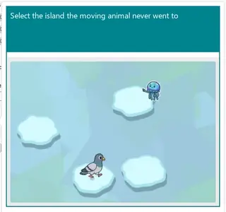<br><sub><b>The island the animal never visited</b> · 30/36 · 29.9 s</sub></td>
    <td align="center" valign="top" width="25%">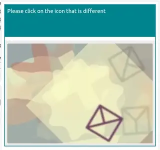<br><sub><b>The icon that is different, moving</b> · 6/6 · 46.2 s</sub></td>
    <td align="center" valign="top" width="25%">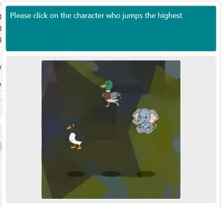<br><sub><b>The character who jumps highest</b> · 34/34 · 31.6 s</sub></td>
    <td align="center" valign="top" width="25%">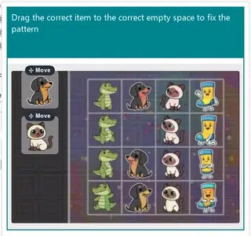<br><sub><b>Drag the piece that fixes the pattern</b> · 1/1 · 32.5 s</sub></td>
  </tr>
  <tr>
    <td align="center" valign="top" width="25%">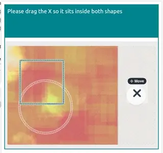<br><sub><b>Drag the X inside both shapes</b> · 28/30 · 23.1 s</sub></td>
    <td align="center" valign="top" width="25%">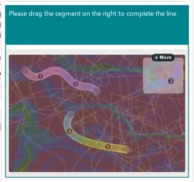<br><sub><b>Drag the segment that completes the line</b> · 27/30 · 7.9 s</sub></td>
    <td align="center" valign="top" width="25%">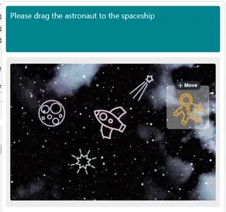<br><sub><b>Drag the astronaut to the spaceship</b> · 14/19 · 13.2 s</sub></td>
    <td align="center" valign="top" width="25%">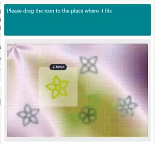<br><sub><b>Drag the icon to where it fits</b> · 16/16 · 9.8 s</sub></td>
  </tr>
  <tr>
    <td align="center" valign="top" width="25%">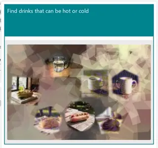<br><sub><b>Drinks that can be hot or cold</b> · 37/37 · 14.5 s</sub></td>
    <td align="center" valign="top" width="25%">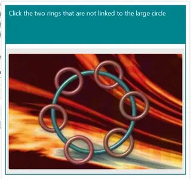<br><sub><b>The rings not linked to the circle</b> · 30/36 · 29.9 s</sub></td>
    <td align="center" valign="top" width="25%">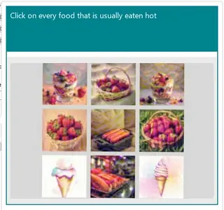<br><sub><b>Foods usually eaten hot</b> · 27/30 · 7.9 s</sub></td>
    <td align="center" valign="top" width="25%">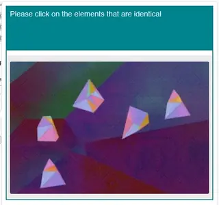<br><sub><b>The elements that are identical</b> · 37/37 · 14.3 s</sub></td>
  </tr>
  <tr>
    <td align="center" valign="top" width="25%">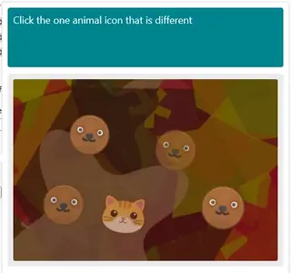<br><sub><b>The animal icon that is different</b> · 14/19 · 13.2 s</sub></td>
    <td align="center" valign="top" width="25%">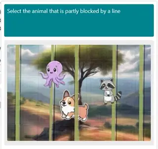<br><sub><b>The animal partly blocked by a line</b> · 14/19 · 13.2 s</sub></td>
    <td align="center" valign="top" width="25%">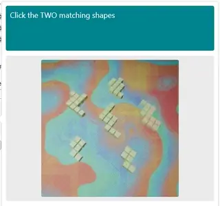<br><sub><b>The two matching shapes</b> · 14/19 · 13.2 s</sub></td>
    <td align="center" valign="top" width="25%">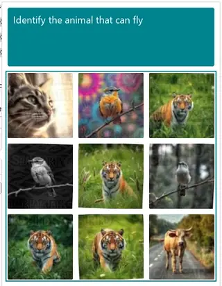<br><sub><b>Grid: the animal that can fly</b> · 2/2 · 7.4 s</sub></td>
  </tr>
  <tr>
    <td align="center" valign="top" width="25%">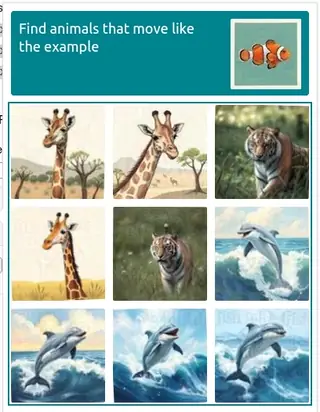<br><sub><b>Grid: animals that move like the example</b> · 4/4 · 8.7 s</sub></td>
    <td align="center" valign="top" width="25%">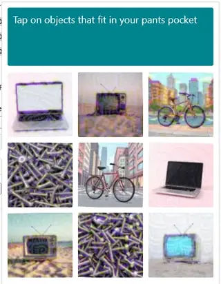<br><sub><b>Grid: what fits in a pocket</b> · 3/11 · 24.3 s</sub></td>
    <td align="center" valign="top" width="25%">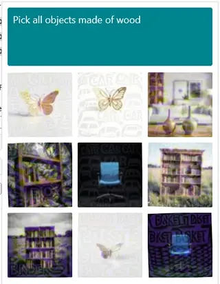<br><sub><b>Grid: objects made of wood</b> · 5/5 · 7.1 s</sub></td>
    <td align="center" valign="top" width="25%">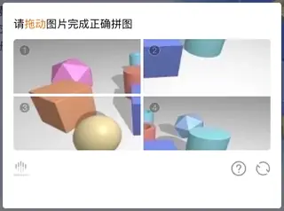<br><sub><b>DingXiang shuffled tiles</b> · 6/6 · 5.9 s</sub></td>
  </tr>
  <tr>
    <td align="center" valign="top" width="25%">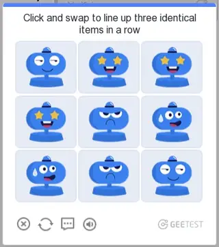<br><sub><b>GeeTest icon crush</b> · 6/6 · 6.1 s</sub></td>
    <td align="center" valign="top" width="25%">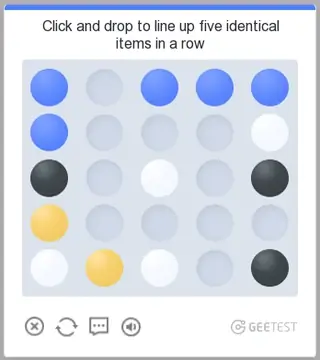<br><sub><b>GeeTest gobang</b> · 6/6 · 6.3 s</sub></td>
    <td align="center" valign="top" width="25%">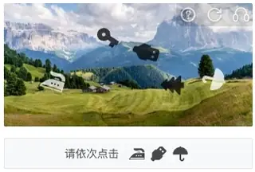<br><sub><b>Icons in order (NetEase Yidun)</b> · 6/6 · 7.8 s</sub></td>
    <td align="center" valign="top" width="25%"><br><sub><b>Characters in order (NetEase Yidun)</b> · 6/6 · 7.7 s</sub></td>
  </tr>
  <tr>
    <td align="center" valign="top" width="25%"><br><sub><b>NetEase Yidun word order</b> · 3/3 · 15.3 s</sub></td>
    <td align="center" valign="top" width="25%"><br><sub><b>NetEase Yidun spatial reasoning</b> · 3/3 · 5.8 s</sub></td>
    <td align="center" valign="top" width="25%">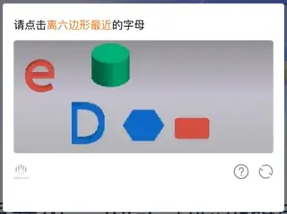<br><sub><b>DingXiang 3D shapes</b> · 6/6 · 3.7 s</sub></td>
    <td align="center" valign="top" width="25%">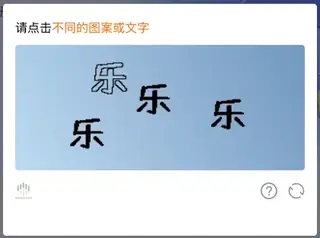<br><sub><b>DingXiang odd one out</b> · 6/6 · 4.1 s</sub></td>
  </tr>
  <tr>
    <td align="center" valign="top" width="25%"><br><sub><b>DingXiang font</b> · 6/6 · 4.7 s</sub></td>
    <td align="center" valign="top" width="25%">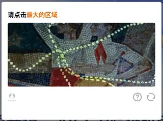<br><sub><b>DingXiang largest area</b> · 6/6 · 5.1 s</sub></td>
    <td align="center" valign="top" width="25%">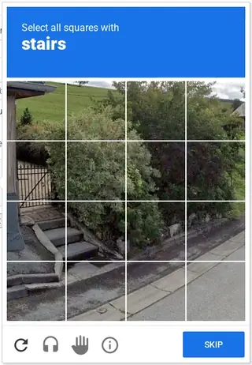<br><sub><b>reCAPTCHA 4×4</b> · 14/14 · 6.6 s</sub></td>
    <td align="center" valign="top" width="25%"><br><sub><b>reCAPTCHA 3×3</b> · 20/22 · 6.5 s</sub></td>
  </tr>
  <tr>
    <td align="center" valign="top" width="25%">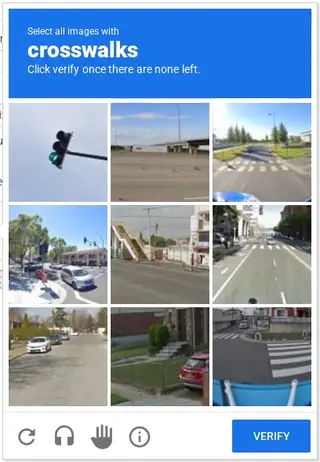<br><sub><b>reCAPTCHA 3×3 dynamic</b> · 4/4 · 18.7 s</sub></td>
    <td align="center" valign="top" width="25%">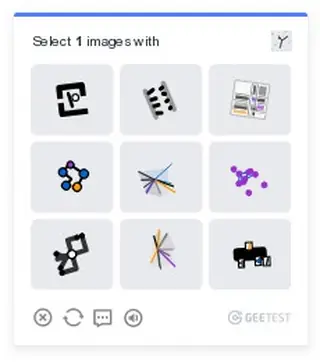<br><sub><b>GeeTest abstract image grid</b> · 3/3 · 37.2 s</sub></td>
    <td align="center" valign="top" width="25%">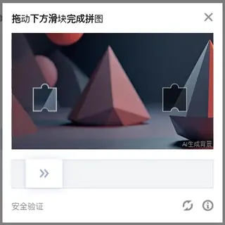<br><sub><b>Tencent slide jigsaw</b> · 6/6 · 6.2 s</sub></td>
    <td align="center" valign="top" width="25%">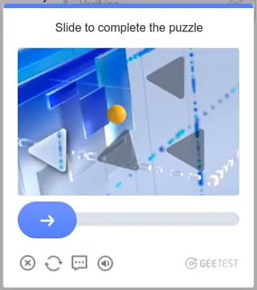<br><sub><b>GeeTest slide jigsaw</b> · 6/6 · 7.7 s</sub></td>
  </tr>
  <tr>
    <td align="center" valign="top" width="25%">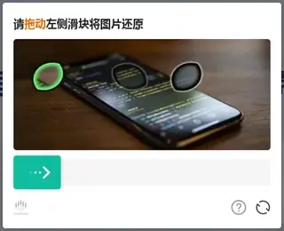<br><sub><b>DingXiang tilted jigsaw</b> · 6/7 · 12.5 s</sub></td>
    <td align="center" valign="top" width="25%"><br><sub><b>DingXiang rotate (WIP)</b> · 6/18 · 11.2 s</sub></td>
    <td align="center" valign="top" width="25%">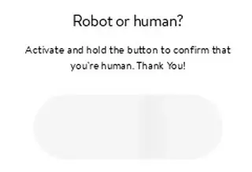<br><sub><b>HUMAN press and hold</b> · 3/3 · 31.5 s</sub></td>
    <td align="center" valign="top" width="25%">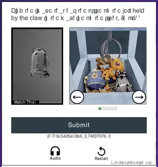<br><sub><b>FunCaptcha claw machine (WIP)</b> · 6/13 · 9.5 s</sub></td>
  </tr>
</table>

Live solves with the pointer drawn in, idle time cut. Each caption is solved/attempts and median solve time for the recording run the clip comes from.

## Quickstart

```bash
npm install captchakraken      # TypeScript
pip install captchakraken      # Python 3.11+
```

Then either use the hosted API (`claude mcp add captchakraken -- npx -y captchakraken-mcp`, then `sign_in` and `create_api_key`; see [docs/hosted-api.md](./docs/hosted-api.md)) or run the model yourself on an 8 GB NVIDIA GPU with `npx captchakraken fetch` ([docs/self-hosting.md](./docs/self-hosting.md)).

```typescript
import { chromium } from 'playwright';
import { CaptchaKrakenSolver } from 'captchakraken';
const page = await (await chromium.launch()).newPage();
await page.goto('https://www.google.com/recaptcha/api2/demo');
await new CaptchaKrakenSolver().solve(page);
```

```python
from playwright.sync_api import sync_playwright
from captchakraken import PageSolver
with sync_playwright() as p:
    page = p.chromium.launch().new_page()
    page.goto("https://www.google.com/recaptcha/api2/demo")
    print(PageSolver().solve(page).is_solved)
```

```python
from playwright.async_api import async_playwright
from captchakraken import AsyncPageSolver  # next release; on dev now
async with async_playwright() as p:
    page = await (await p.chromium.launch()).new_page()
    await page.goto("https://www.google.com/recaptcha/api2/demo")
    print((await AsyncPageSolver().solve(page)).is_solved)
```

Browser frameworks, mobile and touch input, custom selectors and the CLI: [docs/usage.md](./docs/usage.md). Everything else: [docs/](./docs/README.md) and [AGENTS.md](./AGENTS.md).

## Credits

Pointer paths come from [cursory](https://github.com/Vinyzu/cursory) by [Vinyzu](https://github.com/Vinyzu), played through [myuri](https://github.com/JWriter20/Myuri) and its TypeScript port `@jwriter20/myuri` on [cursory-js](https://github.com/JWriter20/cursory-js). All are LGPL-3.0-or-later and installed as ordinary dependencies; see [NOTICE](./NOTICE). The models are fine-tuned from [Qwen3.5](https://huggingface.co/Qwen) (0.8B, 2B and 4B).

## License

[LGPL-3.0-only](./LICENSE) ([COPYING](./COPYING), [plain-English guide](./docs/licensing.md)). Use it lawfully and within the terms of the sites you automate. [Contributing](./CONTRIBUTING.md) · [Changelog](./CHANGELOG.md)
