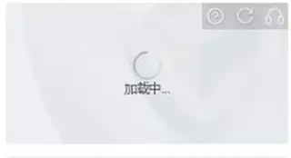
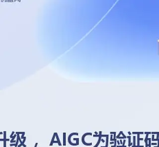

<p align="center">
  <picture>
    <source media="(prefers-color-scheme: dark)" srcset="./docs/assets/logo-dark.svg">
    
  </picture>
</p>

<h1 align="center">CaptchaKraken</h1>

<p align="center">
  <b>A captcha solver for browser automation.</b><br>
  Give it a page — it finds the captcha, reads the puzzle with the v2 pointer
  model, and clicks through to a token.<br>
  Run the model on <b>your own hardware</b>, or call the <b>hosted API</b> and
  run nothing at all.
</p>

<p align="center">
  <a href="https://www.npmjs.com/package/captchakraken"></a>
  <a href="https://pypi.org/project/captchakraken/"></a>
  <a href="./LICENSE"></a>
  <a href="https://github.com/CaptchaKraken/CaptchaKraken/actions/workflows/ci.yml"></a>
</p>

> ⭐ **Enjoying CaptchaKraken?** [Star & watch the repo](https://github.com/CaptchaKraken/CaptchaKraken)
> for new puzzle types and new models. One repo, two
> published ports — the TypeScript browser driver (**npm:** `captchakraken`) and
> the Python engine (**PyPI:** `captchakraken`).

---

<!--
  Animated WebP, not <video>: GitHub strips a <video> whose source is not a
  GitHub upload, fallback link and all, so an image is the only clip that plays
  here. These clips are deliberately NOT the ones on captchakraken.com: the site
  shows its own set of puzzle types, and this page shows other ones.
-->

## Watch it work

A live solve of puzzle types you won't find on the
[captchakraken.com](https://captchakraken.com) demo wall, each driven end to end
by the Python client on a **public page** (recorded 2026-11-13): the vendor's
own demo page, or for press and hold, the block page a public retail site
serves, cropped to the widget.

- **Counts, not percentages.** A handful of attempts is not a percentage, and
  the count is the thing you can actually reason about.
- **The median is measured, not filmed.** It is the time spent inside
  `solve()` on each solved attempt, taken from the run's records. The clips are
  cropped to the widget and trimmed of page loading.
- **It is the whole widget, not one board.** When a vendor rejects an answer
  and deals another board, the clip and the time both include it.

<table>
  <tr>
    <td align="center" valign="top" width="33%"><br><sub><b>NetEase Yidun word order</b><br>click the characters of a phrase in order<br>3/3 solved · median 15.3 s</sub></td>
    <td align="center" valign="top" width="33%"><br><sub><b>NetEase Yidun spatial reasoning</b><br>click what the spatial prompt points to<br>3/3 solved · median 5.8 s</sub></td>
    <td align="center" valign="top" width="33%"><br><sub><b>GeeTest abstract image grid</b><br>pick the one image that matches the icon<br>3/3 solved · median 37.2 s</sub></td>
  </tr>
  <tr>
    <td align="center" valign="top" width="33%"><br><sub><b>HUMAN press and hold</b><br>hold the button until it fills<br>3/3 solved · median 31.5 s</sub></td>
    <td align="center" valign="top" width="33%"><br><sub><b>DingXiang rotate</b> (work in progress)<br>drag the slider until the piece sits upright<br>6/18 solved over four runs · median 11.2 s</sub></td>
    <td></td>
  </tr>
</table>

reCAPTCHA, GeeTest, DingXiang, Tencent and more are on
[captchakraken.com](https://captchakraken.com), with full results including
puzzle types that are measured but not shown anywhere.

---

## Setup

Two ways to run the model. The client code is identical — only the endpoint
changes, so you can switch later by editing one variable.

| | ☁️ **Hosted API** | 🖥️ **Self-hosted** |
|---|---|---|
| You need | Nothing | 8 GB+ of free CUDA VRAM |
| Takes | ~1 minute | One command plus the model download |
| Runs | **Midnight V2 4B Q4** on our fleet | The same weights, on your card |
| Cost | $0.30 per 1,000 image responses. Checkbox and Turnstile are free. | Your electricity |
| Screenshots | Sent to our gateway | Never leave your machine |

**Agents:** the same instructions in a shorter, machine-readable form are in
**[AGENTS.md](./AGENTS.md)**.

### Option 1 — Hosted API

No GPU, no download, no server.

The easiest path is the account MCP server. It signs you in and writes the key
to disk for you, so **you set no environment variables at all**:

```bash
claude mcp add captchakraken -- npx -y captchakraken-mcp
```

Then call `sign_in` (a human approves it in a browser with GitHub — new accounts
get free trial credits), and call `create_api_key`. The key and the endpoint are
written to `~/.captchakraken/credentials`, which the solver reads by itself. The
key is never printed into your terminal or your agent's transcript.

Prefer to do it by hand? Sign in at
**[captchakraken.com/signin](https://captchakraken.com/signin)**, copy your
`ck_live_…` key, and set two variables:

```bash
export VLLM_BASE_URL=https://api.captchakraken.com/v1
export CAPTCHA_KRAKEN_API_KEY=ck_live_your_key_here
```

You are billed per **model response**, not per captcha — one captcha usually
takes 1–2. A single solve attempt is capped at **5 billable responses**, so a
stubborn captcha cannot run up an unbounded bill.

### Option 2 — Self-host

Pick a model, a GPU and how the server should start, and it does the rest:

```bash
npx captchakraken fetch          # or: pipx run captchakraken fetch
captchakraken demo
```

There is nothing to export. `captchakraken start` and `captchakraken stop` turn the
server on and off. It needs an NVIDIA GPU on Linux, and **Midnight V2 4B Q4**, the
default, runs on an 8 GB card. Hardware notes and the rest of the commands:
**[docs/self-hosting.md](./docs/self-hosting.md)**.

> v2 uses a merged pointer model and `/v1/pointer`, not the older chat LoRA
> protocol. GGUF weights are published for advanced llama.cpp integrations;
> stock Ollama cannot evaluate v2's external pointer heads. See
> [The models](#the-models).

**Already run your own vLLM server?** Point at it and skip all of the above. A
non-local URL is never auto-started or managed for you:

```bash
export VLLM_BASE_URL=https://your-server:8000/v1
export CAPTCHA_KRAKEN_API_KEY=your-server-key
```

### Then install the client and solve

Same for every option above. Python needs 3.11+; neither package installs a
browser, so bring your own.

```bash
npm install captchakraken        # TypeScript browser driver
pip install captchakraken        # Python engine + `captchakraken` CLI
```

In the browser — hand it any Playwright-compatible page:

```typescript
import { chromium } from 'playwright';
import { CaptchaKrakenSolver } from 'captchakraken';

const page = await (await (await chromium.launch()).newContext()).newPage();
await page.goto('https://www.google.com/recaptcha/api2/demo');

await new CaptchaKrakenSolver().solve(page);   // detect → solve → click → verify
```

In Python — synchronous Playwright:

```python
from playwright.sync_api import sync_playwright
from captchakraken import PageSolver

with sync_playwright() as p:
    page = p.chromium.launch().new_page()
    page.goto("https://www.google.com/recaptcha/api2/demo")
    print(PageSolver().solve(page).is_solved)
```

Or with no browser at all — a screenshot in, a JSON click plan out:

```bash
captchakraken path/to/captcha.png
```

Check your setup any time with `captchakraken server status`. Every browser
framework (Playwright, Patchright, camoufox, Puppeteer) and the background
watcher are in **[docs/usage.md](./docs/usage.md)**.

**On a phone?** How the solver *performs* the answer is a choice of input
device, not a realism dial:

```typescript
new CaptchaKrakenSolver({ humanization: 'mobile' })   // touch events, finger kinematics
new CaptchaKrakenSolver({ humanization: 'none' })     // straight to the DOM effect
new CaptchaKrakenSolver({ humanizer: myOwn })         // yours
```

**Short on time?** `speed: 'fast'` (or `CAPTCHA_SPEED=fast`) plays the same
human paths 2.5x faster and halves the waits between gestures; `humanizeSettings`
passes any [myuri setting](https://github.com/JWriter20/Myuri#settings) straight
through.

`mobile` never touches `page.mouse` — a mousemove at a touch-only widget is the
wrong event, not a weaker one. It drives a Chromium page with `hasTouch: true`,
or a real handset over **Appium / WebdriverIO / Selenium** via `touchDriver`.
Full details in
[docs/usage.md § How it moves](./docs/usage.md#how-it-moves--mouse-mobile-none-or-yours).

**Your own captcha?** Every URL pattern and selector the solver uses is in
[`captchakraken.config.json`](./captchakraken.config.json). Write a file with a
`custom` entry for a captcha it does not know, and pass it in:

```typescript
new CaptchaKrakenSolver({ selectors: './my-captchas.json' })
```

```python
PageSolver(config=PageSolverConfig(selectors="my-captchas.json"))
```

It is laid over the defaults, so it holds only what it changes. Details in
[docs/usage.md § Selectors and URL patterns](./docs/usage.md#selectors-and-url-patterns-captchakrakenconfigjson).

**Stay current** — pull the latest model + engine in one step, no reinstall:

```bash
captchakraken fetch
```

---

## What it solves today

CaptchaKraken detects the captcha, solves it, clicks, and verifies — end to end.

| Captcha type | Status |
|---|---|
| ✅ Checkbox / "I'm not a robot" | Works end-to-end |
| ✅ **reCAPTCHA 3×3** (dynamic refresh) | Works end-to-end |
| ✅ **reCAPTCHA 4×4** (one-shot) | Works end-to-end |
| ✅ Cloudflare Turnstile | Works via the checkbox flow |
| ✅ **GeeTest** (v3 + v4) | Slide, icon, nine, svg. `gobang` and `iconcrush` are weak — see below |
| ✅ **NetEase Yidun** | Jigsaw, picture-click, icon-click |
| ✅ **Lemin, Prosopo, Tencent** | Cropped-image, grid, and slide flows |
| ✅ **Distorted text** | BotDetect, MTCaptcha, Yandex — read and typed, not clicked |
| ✅ **Animated / video challenges** | Recorded, cut into keyframes, solved as one multi-image prompt, then clicked once the widget returns to the chosen frame |

Beyond reCAPTCHA, the vendors in this table are driven end-to-end in CI against
generated fixtures in **both** ports. Per-vendor accuracy varies more than the
headline grids do, and the clips above are the per-type record: each one is that puzzle
driven on the vendor's own demo page, with every attempt scored. GeeTest's
gobang and icon-crush boards were long the two weakest — both drive to
completion now (10/10 and 9/10 above) but they are the least exercised of the
set, so they are the likeliest to move.

### Accuracy, measured

**The headline numbers are the clips at the top of this page.** Each one is
that puzzle driven on the vendor's own public demo page through the hosted API,
with every attempt scored — counts, not percentages, and a median solve time
computed from the run rather than from the footage. Recorded 2026-08-19 against
`captcha-v12`, the legacy adapter used for these historical measurements.

That is deliberately the *end-to-end* number: detect, read, click, verify, and
the vendor accepting. It is the one you can hold us to, because it is the one
you experience.

An earlier revision of this section carried per-type **model** accuracy taken on
2026-07-27. Those figures were withdrawn — the eval split of the day let some
hand-labeled captures reach training, so they measured memorisation alongside
skill. The split was replaced (**every** real capture is held out; nothing
hand-labeled trains) and the model has been re-measured against it since. Those
re-measured rates are published on the benchmark page below, never on their own:
a bare model score tells you very little about whether a captcha clears, so it is
printed beside the browser counts rather than instead of them.

The method behind them, so you can reproduce the shape of it: exact set match —
every correct tile and no incorrect ones, no partial credit, because a
partially-correct grid answer is a rejected captcha — taken over the full
customer path (HTTPS → gateway → vLLM) rather than a local checkpoint, against
captures the adapter has never trained on.

> **Grids are sent with the cell numbers drawn on** (v1 chat models). `solver.py`
> reads the cell boxes from the reCAPTCHA challenge frame's tiles, renders `get_numbered_grid_overlay` (red labels, top-right, all
> cells 1..N — byte-identical to the overlay the training data was built with)
> and sends *that*. This is not cosmetic: measured on raw un-numbered
> screenshots the same model scores **0% on 4×4**, because it has to invent a
> numbering convention for sixteen cells of one continuous photograph and
> answers `1..k`. If you are building your own client, draw the overlay.

**Both tables, one page: [docs/benchmarks.md](./docs/benchmarks.md).** That is
the canonical benchmark page — the browser runs above in full, and beside them
the per-puzzle model accuracy over held-out real captures, scored the way a
widget scores. Two measurements, because they answer two different questions; a
figure quoted anywhere else in this repo is a copy of one of them.

Method, per-device speed tables, and why browser solve rates differ from model
accuracy: **[docs/performance.md](./docs/performance.md)**.

---

## The models

### v2 — current

The v2 architecture is a vision-language pointer model that reads the bare
board. The server owns the fixed prompt and exposes `POST /v1/pointer`; clients
send a board and receive points, paths, text, or a no-answer decision.

The client runs no detector model of its own. Measured on real boards, the
pointer models score higher on bare boards than on boards with numbered marks
drawn on (TwilightV2-2B 72.6% plain vs 68.2% marked; MidnightV2-4B q4 75.1% vs
70.8%), and leaving the detector out keeps the client light.

| Family | Parameters | Formats |
|---|---|---|
| **Sunlight V2** | 0.8B | bf16, Q4, LoRA, GGUF |
| **Twilight V2** | 2B | bf16, LoRA, GGUF |
| **Midnight V2** | 4B | bf16, Q4, LoRA, GGUF |

Every repository is in the [CaptchaKraken v2 collection](https://huggingface.co/collections/CaptchaKraken/captchakraken-v2).
The default for both self-hosting and the hosted API is **Midnight V2 4B Q4**.

The published Sunlight V2 pointer heads predate this release's head layout and fail a
strict load, so use Twilight V2 or Midnight V2 until they are republished.

`captchakraken fetch` installs a merged model and its pointer heads.
The LoRA repositories are for further training. GGUF repositories include the
vision projector and pointer heads for custom llama.cpp integrations; stock
Ollama and `llama-server` alone cannot evaluate those heads and are not a
supported CaptchaKraken server.

Earlier chat-completion releases remain registered for existing pinned clients.
They use a different prompt protocol and cannot serve a v2 client.

| If | Use |
|---|---|
| You have no GPU | the [hosted API](./docs/hosted-api.md) |
| You want the supported one-command setup | **Midnight V2 4B Q4** — `npx captchakraken fetch` |
| You want full precision | Midnight V2 4B, from the same menu |
| You are building a custom llama.cpp runtime | a **v2 GGUF** repository |

Serving details: **[docs/self-hosting.md](./docs/self-hosting.md)**.

---

## Solves

### What a solve actually looks like

One inference round sends a board to `POST /v1/pointer`. The server owns the
prompt, runs the model and its pointer heads on the bare board, and returns an
action plan:

```json
{"action": "click", "points": [[375, 262], [625, 262]]}
```

The response also includes the detected elements and the board dimensions.
Grids and interactive elements carry numbers drawn on the image so the client
can connect each point to the element it belongs to.

The browser driver wraps this: it finds the grid, converts cell numbers into
click coordinates, clicks, waits for tiles to refresh, and re-solves until the
challenge clears. What the CLI hands back to it is bounding boxes rather than
cell indices:

```jsonc
{
  "actions": {
    "action": "click",
    "target_bounding_boxes": [
      [0.010, 0.206, 0.335, 0.418],
      [0.335, 0.206, 0.660, 0.418],
      [0.335, 0.631, 0.660, 0.843]
    ]
  },
  "token_usage": [{ "prompt_tokens": 348, "completion_tokens": 10 }]
}
```

### End-to-end, in a real browser

The run below drove **live reCAPTCHA challenges** at
`google.com/recaptcha/api2/demo` on 2026-07-27, headless, against the hosted
API. A "solve" means reCAPTCHA accepted and the widget cleared — not that the
model's first answer was right.

| Browser | Solved | Rounds billed | Median wall clock |
|---|---:|---:|---:|
| [Camoufox](https://camoufox.com) 0.4.11 | **3 / 3** | 21 | 96 s |

A solve took 5–8 model rounds, because reCAPTCHA replaces tiles after each
click and every replacement is a fresh puzzle. That is the whole reason the
hosted API meters per round rather than per solve.

**Solve rate in a browser is not model accuracy, and much of it is your IP.**
reCAPTCHA rejects correct answers from addresses it distrusts, and the run above
came from a datacenter address — which is the least favourable condition there
is. The figure is not a benchmark; it is proof the path works. See
[Rate limiting & IP reputation](./docs/performance.md#rate-limiting--ip-reputation).

Reproduce it yourself — the demos in this repo drive a real browser end to end:

```bash
cd js
npm install && npm i -D camoufox-js tsx   # example-only deps
npx camoufox-js fetch                     # one-time browser download

npx tsx examples/demoRecaptcha.ts                      # the demo page above
npx tsx examples/demoRecaptcha.ts https://your.site/   # or your own page
```

Add `--headed` to watch it happen in a visible window. The Python engine ships
the same demo — `cd python && python examples/demoRecaptcha.py` — and it takes
the same arguments.

---

## Documentation

Most of the detail lives in the docs hub — start at **[docs/](./docs/README.md)**.

| Guide | What's in it |
|---|---|
| ☁️ [Hosted API](./docs/hosted-api.md) | Sign in, keys, pricing, per-session billing, error codes |
| 📦 [Self-hosting](./docs/self-hosting.md) | `captchakraken fetch`, model sizes, server management, config, **updating** |
| 🚀 [Usage](./docs/usage.md) | Install, the 4 browser frameworks, **mouse / mobile / no humanization**, the Python CLI, migrating from v1 |
| ⚙️ [How it works](./docs/how-it-works.md) | The solve pipeline, grid cells from the DOM, the freshness guard, dedup |
| 📊 [Benchmarks](./docs/benchmarks.md) | The canonical numbers: real captchas in a browser, and per-puzzle model accuracy |
| ⚡ [Performance](./docs/performance.md) | Speed-by-device tables, IP-reputation & rate limits |
| 🗺️ [Roadmap](./docs/roadmap.md) | What shipped, what's in progress, and what's planned |
| 📜 [Licensing](./docs/licensing.md) | Plain-English: what you can and can't build |

---

## Roadmap

- 🟢 **Shipped** — the **hosted API** (`api.captchakraken.com`, self-serve
  signup), a mid-inference **freshness guard** (never act on a stale frame),
  and a one-command **`captchakraken fetch`** updater.
- 🟢 **Shipped** — **v2**: the pointer architecture (the CNN detector is no
  longer part of the client), one-command vLLM hosting, and public Sunlight 0.8B, Twilight 2B, and Midnight
  4B weights in the [v2 collection](https://huggingface.co/collections/CaptchaKraken/captchakraken-v2).
- 🟢 **Shipped** — **Midnight V2 4B Q4** as the default for both self-hosting
  and the hosted API.
- ⚪ **Planned** — 🎯 higher accuracy on the **freehand drag and path puzzles**
  (connect-the-path and the numbered-line / missing-piece drags), which are the
  families the model is least reliable on. Every family we ship is already
  routed and driven — this is about how often they land, not whether they are
  attempted.

The visual, always-current version is in **[docs/roadmap.md](./docs/roadmap.md)**.
📣 **[Watch the repo](https://github.com/CaptchaKraken/CaptchaKraken)** to hear about
these as they ship.

---

## License

CaptchaKraken and all its models are **LGPL-3.0-only** — see
**[LICENSE](./LICENSE)**, **[COPYING](./COPYING)**, and the plain-English
**[licensing guide](./docs/licensing.md)**. Commercial use, modification, and
redistribution are permitted under LGPLv3, including use in browsers, automation
products, and hosted APIs. Distributed modifications to CaptchaKraken itself must
remain available under LGPLv3.

---

## Contributing

PRs welcome — see [CONTRIBUTING.md](CONTRIBUTING.md). CI runs a hermetic
no-regression suite (grid detection, the freshness check, and the fetch command)
plus a TypeScript build on every PR — no GPU or network. Release notes:
[CHANGELOG.md](CHANGELOG.md).

---

## Credits

**The mouse is not ours.** Every pointer path this driver performs comes from
**[cursory](https://github.com/Vinyzu/cursory)**, by
**[Vinyzu](https://github.com/Vinyzu)**. It does not model a hand: it searches a
database of thousands of trajectories recorded from real people for the closest
match to the requested movement, morphs that recording onto the endpoints, and
re-noises it — realism that is measured rather than asserted. It replaced the
hand-tuned curves we shipped before it; see
[docs/usage.md § How it moves](./docs/usage.md#how-it-moves--mouse-mobile-none-or-yours).

We drive it through **[myuri](https://github.com/JWriter20/Myuri)**, which
plays those recordings at a mouse's report rate, draws one consistent person per
seed (speed, overshoot, typing rhythm), and times keystrokes and typos the way
people make them. Its TypeScript port `@jwriter20/myuri` runs on
**[cursory-js](https://github.com/JWriter20/cursory-js)**, our port of cursory,
so a seed gives the same path in both drivers.

All of them are **LGPL-3.0-or-later**, and all are ordinary installed
dependencies — never vendored, inlined, or bundled — so you can swap in a
modified build of any of them by reinstalling the package. Full third-party notice: **[NOTICE](./NOTICE)**.

---

> ⚠️ Use responsibly and lawfully — respect the terms of service of any site you
> interact with. This project is for legitimate automation, research, and testing.
