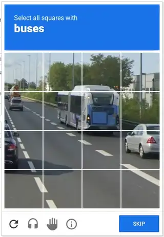
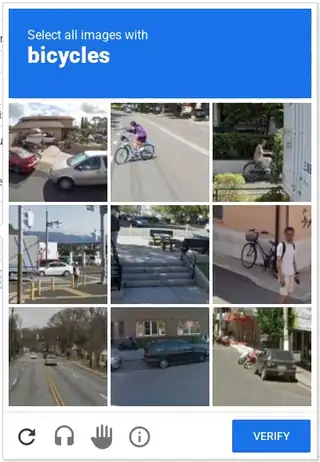
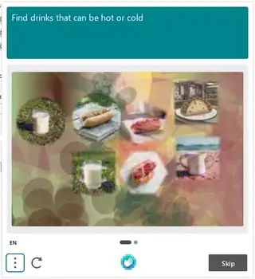
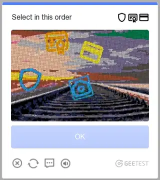
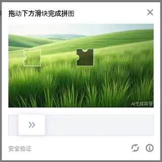
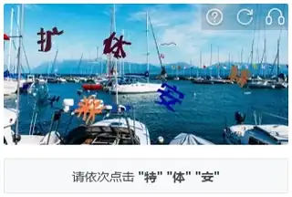
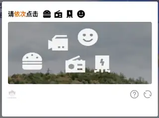

<p align="center">
  
</p>

<h1 align="center">captchakraken</h1>

<p align="center">
  <b>A captcha solver for browser automation.</b><br>
  The Python engine and CLI behind <a href="https://github.com/CaptchaKraken/CaptchaKraken">CaptchaKraken</a>.
</p>

CPU element detection plus a fine-tuned **Qwen3.5-9B** vision model. Give it a
screenshot of a captcha and it returns the plan to solve it — which tiles to
select, where to click, what to drag, how far to slide, or what text to type.
Ships the `captchakraken` command.

Run the model on **your own hardware**, or point it at the **hosted API** and run
nothing at all.

> For demo videos, accuracy numbers, the browser driver, and the full
> self-hosting guide, see the main repo
> **[CaptchaKraken](https://github.com/CaptchaKraken/CaptchaKraken)**.

## Watch it work

<table>
  <tr>
    <td align="center" width="33%"><br><sub><b>reCAPTCHA 4×4 tile grid</b><br>14/14 solved · median 6.6 s</sub></td>
    <td align="center" width="33%"><br><sub><b>reCAPTCHA 3×3 tile grid</b><br>20/22 solved · median 6.5 s</sub></td>
    <td align="center" width="33%"><br><sub><b>Canvas drag puzzle</b><br>37/37 solved · median 7.3 s per board</sub></td>
  </tr>
  <tr>
    <td align="center" width="33%"><br><sub><b>GeeTest slide jigsaw</b><br>6/6 solved · median 7.7 s</sub></td>
    <td align="center" width="33%"><br><sub><b>GeeTest ordered icon click</b><br>6/7 solved · median 7.6 s</sub></td>
    <td align="center" width="33%"><br><sub><b>GeeTest 3×3 photo grid</b><br>6/6 solved · median 6.9 s</sub></td>
  </tr>
  <tr>
    <td align="center" width="33%"><br><sub><b>Tencent slide jigsaw</b><br>6/6 solved · median 6.2 s</sub></td>
    <td align="center" width="33%"><br><sub><b>NetEase Yidun characters in order</b><br>6/6 solved · median 7.7 s</sub></td>
    <td align="center" width="33%"><br><sub><b>DingXiang icon click</b><br>6/6 solved · median 7.6 s</sub></td>
  </tr>
</table>

Recorded 2026-11-15 on each vendor's own public demo page through the hosted
API (**CaptchaKraken Abyss**), one solve at a time. Counts rather than
percentages, because a handful of attempts is not a percentage. The median is
the measured time from the challenge opening to the vendor verifying it, taken
from the run and never from the footage. Idle time is cut from the clips, so
they run shorter than the solves they show. The canvas puzzle deals a varying
number of boards per challenge, so it is timed per board.

**Every puzzle type**, with the full results table, at
[captchakraken.com](https://captchakraken.com).

## What it solves

| Vendor | Puzzles |
|---|---|
| **reCAPTCHA** | 3×3 and 4×4 image grids, including the dynamic re-deal |
| **GeeTest** v3 + v4 | Slide, icon, nine, svg, gobang, iconcrush |
| **NetEase Yidun** | Jigsaw, picture-click, icon-click |
| **Tencent, Lemin, Prosopo** | Slide, cropped-image and grid flows |
| **BotDetect, MTCaptcha, Yandex** | Distorted text — read and typed, not clicked |
| **Cloudflare Turnstile** | Via the checkbox flow (free on the hosted API) |

**44 puzzle types**, driven end to end in CI against generated fixtures on both
the TypeScript and Python ports. Animated challenges are recorded, sliced into
keyframes and answered with the frame the action belongs to.

## Install

```bash
pip install captchakraken            # client: CPU element detection + vLLM HTTP planner
pip install "captchakraken[serve]"   # + the serving stack (vLLM/torch) to self-host
```

The base install is lightweight — everything you need to solve captchas against
a vLLM server (local or remote). The `[serve]` extra pulls the heavy stack only
if you want to run the model yourself. To skip all of that, `pipx run captchakraken
fetch` asks which model and GPU you want, then installs, downloads and starts it,
and `captchakraken demo` tries it.

## No GPU? Use the hosted API

Point the client at `https://api.captchakraken.com/v1` and run no model at all.
Sign in at [captchakraken.com/signin](https://captchakraken.com/signin) for a
`ck_live_…` key, or let the MCP server write one for you:

```bash
claude mcp add captchakraken -- npx -y captchakraken-mcp
# then call sign_in, then create_api_key
```

`create_api_key` writes the key and the endpoint to `~/.captchakraken/credentials`,
which the client reads on its own — **no environment variables needed**.

## Hands-off server

The vLLM server is managed for you. On your first solve, if the configured
endpoint is **local** and nothing is listening, a server is started
automatically and reused. Point `VLLM_BASE_URL` at a server you already run to
skip local management entirely.

```bash
captchakraken server start | stop | status | run
```

## Usage

```bash
# Solve an image/video: classify → plan. Prints the click actions.
captchakraken path/to/captcha.png
captchakraken path/to/captcha.png --puzzle-source recaptcha
```

```python
from captchakraken import CaptchaSolver

solver = CaptchaSolver()          # connects to / auto-starts a local vLLM
actions = solver.solve("captcha.png")
```

Pixel tool subcommands (CPU only, no model): `find-checkbox`, `grid-cell-states-fixed`
(takes the grid boxes as JSON), and a persistent `serve` worker the browser driver polls.

## Configuration (model-agnostic)

Everything model-specific lives in `captchakraken.config` and is env-overridable
— the solver never hard-codes a model.

| Variable | Meaning | Default |
|---|---|---|
| `VLLM_BASE_URL` | Inference endpoint | `~/.captchakraken/credentials`, else `http://localhost:8000/v1` |
| `CAPTCHA_KRAKEN_API_KEY` | Bearer token (`VLLM_API_KEY` also accepted) | `~/.captchakraken/credentials`, else `EMPTY` |
| `CAPTCHA_BASE_MODEL` | Base weights vLLM loads | `RedHatAI/Qwen3.5-9B-FP8-dynamic` |
| `CAPTCHA_LORA_ADAPTER` | Captcha adapter (HF id or path) | `CaptchaKraken/CaptchaKraken-Lora-v1.2` |
| `CAPTCHA_LORA_NAME` | Served adapter name the client requests | `captcha-v12` |
| `CAPTCHA_KRAKEN_AUTOSTART` | `0` disables local auto-start | `1` |
| `CAPTCHA_HUMANIZATION` | How gestures are performed: `mouse`, `mobile` or `none` | `mouse` |

**How it moves** is a choice of input device, not a realism dial. `mobile`
dispatches real touch events with finger kinematics and never touches
`page.mouse`; `none` goes straight to the DOM effect. Set it in code (which wins
over the env var, because the right mode is a property of the page you are
driving), and pass your own object to override ours entirely:

```python
from captchakraken import PageSolver
from captchakraken.page_solver import PageSolverConfig

PageSolver(config=PageSolverConfig(humanization="mobile"))
PageSolver(config=PageSolverConfig(humanization="none"))
PageSolver(config=PageSolverConfig(humanizer=my_own))

# A real handset over Appium / Selenium — W3C touch pointer actions.
PageSolver(config=PageSolverConfig(
    humanization="mobile",
    touch_driver=driver,
    touch_transform={"scale": 3.0, "origin": (0, 132)},   # CSS px -> screen px
))
```

## License

**LGPL-3.0-only** — see [LICENSE](./LICENSE). Use, modify and redistribute it,
including in commercial and hosted services. If you distribute a modified
version, keep the licence and copyright notices and make your changes available
under LGPLv3.
